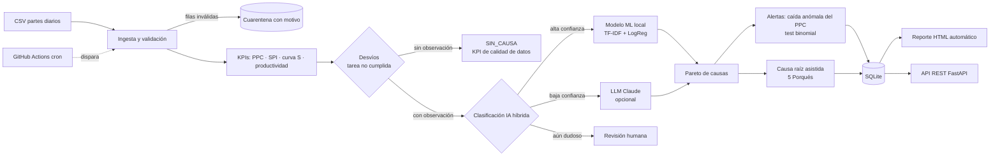

# ObraPulse

**Control automático del cumplimiento de planificación de obra (PPC) y análisis de causas de incumplimiento con IA.**

[](https://github.com/LuucianoTissera/obrapulse/actions)


> Proyecto de portfolio de **ingeniería de procesos aplicada a construcción**. Toma los partes diarios de obra
> (donde el capataz anota qué se planificó, qué se ejecutó y por qué no se llegó, en texto libre), clasifica las causas
> con IA, calcula PPC / SPI / curvas S, detecta caídas anómalas del cumplimiento, propone análisis de causa raíz
> (5 Porqués) y genera un reporte automático. Todo con un solo comando.

> ⚠️ Los datos incluidos son **sintéticos** (generados por `generator.py`). No pertenecen a ninguna empresa ni obra real.

---

## El problema

En obra, la planificación rara vez se cumple como se programó. La literatura de Lean Construction (Last Planner System)
mide esa confiabilidad con el **PPC** (*Percent Plan Complete*: % de tareas planificadas que se completaron) y propone
analizar sistemáticamente las **causas de no cumplimiento (CNC)** para mejorar. En la práctica ese análisis es manual:

- Alguien lee cientos de observaciones de partes diarios ("no llegó el hormigón", "se rompió la retro", "lluvia").
- Las agrupa en planillas, con criterios distintos según quién lo haga.
- El informe llega tarde, cuando la causa ya costó semanas de atraso.
- Muchos desvíos ni siquiera tienen causa registrada, así que no se puede mejorar lo que no se sabe por qué pasó.

## La solución



### Qué se automatiza

| Antes (manual) | Ahora (automático) |
|---|---|
| Leer y etiquetar cada observación | Clasificación de causas por IA con nivel de confianza |
| Calcular PPC y avance en planillas | PPC, SPI y curvas S reproducibles por obra |
| Armar el Pareto de causas | Pareto por valor no ejecutado y horas-hombre perdidas |
| Notar el problema cuando ya es tarde | Alerta estadística de caída de PPC por obra, con causa dominante |
| Análisis de causa raíz "a criterio" | Hipótesis estandarizadas de 5 Porqués + acciones |
| Detectar mala carga de datos a ojo | Cuarentena de filas inválidas y KPI de desvíos sin causa |
| Informe semanal manual | Reporte HTML generado cada lunes (GitHub Actions) |

## Indicadores

| Indicador | Definición |
|---|---|
| **PPC** | Tareas cumplidas / tareas planificadas. Una tarea se considera cumplida si ejecuta ≥ 95 % de lo planificado |
| **SPI** | Valor ejecutado / valor planificado acumulado (< 1 = atraso) |
| **Valor no ejecutado** | (planificado − ejecutado) × precio unitario, solo en tareas no cumplidas |
| **HH perdidas** | Horas-hombre asignadas × fracción no ejecutada, solo en tareas no cumplidas |
| **Productividad** | Unidades ejecutadas por hora-hombre, por actividad |

## Inicio rápido

```bash
git clone https://github.com/LuucianoTissera/obrapulse.git
cd obrapulse
python -m venv .venv && source .venv/bin/activate      # Windows: .venv\Scripts\activate
pip install -e ".[dev]"

obrapulse demo        # genera datos, entrena el modelo, corre el pipeline
# -> abrí reports/reporte_latest.html
```

Sin API key funciona completo (modo ML + reglas). Con `ANTHROPIC_API_KEY` se activa el escalamiento a LLM.

### Con Docker

```bash
docker build -t obrapulse .
docker run -p 8000:8000 obrapulse        # API en http://localhost:8000/docs
# o: docker compose up
```

### Formato de entrada (`partes_diarios.csv`)

`registro_id, fecha, obra, actividad, unidad, cantidad_planificada, cantidad_ejecutada, horas_hombre, precio_unitario, observacion`

Para usar datos propios: `obrapulse run --partes ruta/a/partes.csv` (y reentrenar con `obrapulse train --data historico.csv`,
un CSV con columnas `descripcion,categoria`).

## API REST

```bash
obrapulse serve      # http://127.0.0.1:8000/docs  (Swagger)
```

| Endpoint | Descripción |
|---|---|
| `GET /health` | Estado del servicio |
| `POST /classify` | Clasifica una observación en texto libre → causa, confianza, método, ¿revisión? |
| `GET /kpis?obra=VIAL-01` | PPC, SPI, valor y HH perdidas |
| `GET /obras` | Resumen por obra |
| `GET /datos` | Detalle enriquecido de partes, con filtros de obra/fecha y paginación (Power BI) |
| `GET /curva-s` | Serie por fecha y obra: PV, EV y acumulados para la curva S |
| `GET /calidad-datos` | Partes válidos/rechazados y registros que requieren revisión |
| `GET /pareto?por=categoria\|obra\|actividad` | Pareto de valor no ejecutado |
| `GET /anomalies` | Obras con caída anómala del PPC en la última semana |
| `GET /report` | Último reporte HTML |

### Power Query y Power BI

Las consultas M listas para importar, el modelo recomendado, las medidas DAX y el diseño del dashboard están en [`powerbi/README.md`](powerbi/README.md). La integración utiliza `/datos`, `/obras`, `/curva-s`, `/pareto`, `/anomalies` y `/calidad-datos`; requiere ejecutar `obrapulse run` para actualizar los datos procesados.

```bash
curl -X POST localhost:8000/classify -H 'content-type: application/json' \
  -d '{"descripcion":"no llegó el hormigón, demora del proveedor"}'
```

## Integración con Microsoft Power Platform

ObraPulse incluye una integración de análisis con **Power BI mediante Power Query y la API REST de FastAPI**. Las consultas M consumen los endpoints de datos, resumen de obras, curva S, Pareto, anomalías y calidad de datos.

Como módulo complementario de gestión, se construyó una aplicación en **Power Apps** conectada a una tabla **Dataverse** (`Desvío de Obra`) y un flujo de **Power Automate** que detecta el registro de un nuevo desvío y envía un aviso por correo (Outlook) al responsable. La evidencia con capturas está en [`docs/EVIDENCIAS.md`](docs/EVIDENCIAS.md).

> Alcance actual: Power Apps, Dataverse y Power Automate funcionan entre sí para registrar y detectar nuevos desvíos. Ese flujo todavía no llama directamente a la API Python ni modifica la base SQLite. La arquitectura, configuración y evidencias esperadas están documentadas en [`docs/POWER_PLATFORM.md`](docs/POWER_PLATFORM.md).

Para la conexión de Power BI con FastAPI y las consultas M, consultar [`powerbi/README.md`](powerbi/README.md).

## Configuración (variables de entorno, ver `.env.example`)

| Variable | Default | Descripción |
|---|---|---|
| `CLASSIFIER_MODE` | `hybrid` | `hybrid` · `ml` · `llm` · `rules` |
| `CONFIDENCE_THRESHOLD` | `0.70` | Bajo este umbral → escala al LLM y/o marca para revisión humana |
| `LLM_MAX_CALLS` | `200` | Tope de llamadas al LLM por corrida (control de costos) |
| `ANTHROPIC_API_KEY` | – | Opcional. Habilita LLM |
| `API_KEY` | – | Si se define, la API exige el header `X-API-Key` |

## Decisiones de diseño (y por qué)

1. **IA híbrida, no "todo al LLM".** Un modelo ML clásico (TF-IDF + regresión logística) resuelve la mayoría de los casos
   gratis, en milisegundos y sin enviar datos fuera. El LLM solo interviene donde el modelo duda → menor costo, latencia y riesgo.
2. **Degradación elegante.** Sin LLM → ML. Sin modelo → reglas. El sistema nunca queda caído por una dependencia externa.
3. **Humano en el circuito.** Lo que sigue dudoso se marca `requiere_revision` en lugar de adivinar.
4. **Los desvíos sin observación no pasan por la IA.** Inventar una causa sería peor que reconocer que falta el dato:
   se registran como `SIN_CAUSA` y se reportan como KPI de calidad del proceso de carga.
5. **Test binomial para las alertas, no z-score.** Cada tarea es un resultado discreto (cumple / no cumple) y hay pocas por día;
   un z-score diario carece de potencia. El test binomial unilateral (α = 0,01) acumula la evidencia de la última semana y responde:
   ¿el incumplimiento reciente supera significativamente el histórico *de esa obra*? Es unilateral: una mejora no genera alerta.
6. **Causa dominante por frecuencia** (como el CNC de Last Planner), más estable que por valor cuando hay pocos eventos.
7. **Validación con cuarentena.** Las filas inválidas no se borran en silencio: se guardan con el motivo del rechazo.
8. **El LLM es una fuente no confiable:** su salida se valida contra la taxonomía, el texto del capataz se trata como dato
   (mitigación de prompt injection) y los errores degradan al fallback.
9. **Las sugerencias de causa raíz se presentan como hipótesis** a validar en obra, nunca como conclusiones.

## Estructura

```
src/obrapulse/
  ingestion.py     validación + cuarentena
  classifier/      rules.py · ml.py · llm.py · service.py (orquestador híbrido)
  kpis.py          PPC, SPI, curva S, Pareto, productividad
  anomalies.py     test binomial de caída de PPC + causa dominante
  rca.py           5 Porqués asistido (LLM o playbook)
  storage.py       SQLite
  reporting.py     reporte HTML (gráficos embebidos)
  pipeline.py      orquestación end-to-end
  api.py · cli.py  interfaces
tests/             40 tests (KPIs verificados a mano, validación, fallbacks, API, detección exacta de la anomalía inyectada)
.github/workflows/ CI (lint + tests + build Docker) y reporte semanal programado
```

## Limitaciones conocidas (honestidad técnica)

- Los datos son sintéticos: el accuracy (~89 %) **no es extrapolable** a una obra real; hay que reentrenar con histórico etiquetado propio.
- El test de alertas necesita ~una semana de datos (≥ 8 tareas) y una caída marcada para dispararse (potencia limitada con pocas tareas).
  Para detectar cambios más sutiles hay que ampliar la ventana.
- El PPC depende de que las "tareas planificadas" del parte reflejen el plan semanal real (compromisos del Last Planner), no solo el cronograma maestro.
- El valor no ejecutado usa precios unitarios del parte; no considera costos indirectos ni penalidades.
- SQLite alcanza para este volumen; para multi-obra con concurrencia se migraría a PostgreSQL (solo cambia `storage.py`).
- El camino con LLM está cubierto por tests con un doble (sin red); requiere validación con API key y datos reales.

## Roadmap

- Carga de partes desde formularios móviles / WhatsApp y conexión a ERP / sistema de gestión de obras.
- Ciclo de retroalimentación: las correcciones humanas reentrenan el modelo (active learning).
- Alertas proactivas (email / Teams / WhatsApp) al detectar caídas de PPC.
- Restricciones y *look-ahead* a 3 semanas (liberación de restricciones del Last Planner).
- Ampliación de indicadores de costos y desvío presupuestario (CPI).

## Desarrollo

```bash
make test     # pytest
make lint     # ruff
make demo     # pipeline completo
```

## Licencia

MIT.
