# ObraPulse — Evidencia de integraciones

ObraPulse detecta y analiza desvíos de planificación en obras. Este repositorio documenta las integraciones del proyecto con **Power Apps, Power Automate, Dataverse y Power BI**, y con una **API propia** que calcula los indicadores (PPC, SPI), clasifica las causas de no cumplimiento y genera un reporte.

> Los datos de análisis son **sintéticos, de demostración** (período 2026-08-03 → 2026-10-24, 4 obras, 864 partes).

## Arquitectura

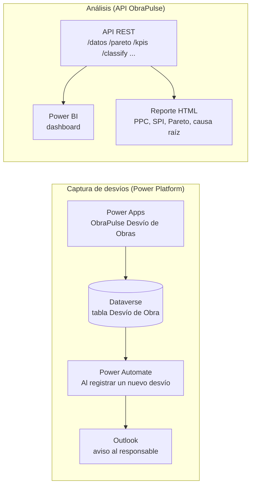

## 1. Captura de desvíos con Power Platform

| # | Evidencia | Qué demuestra |
|---|---|---|
| 01 | 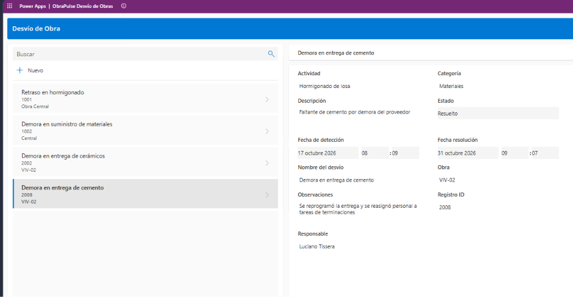 | App de Power Apps con el desvío "Demora en entrega de cemento" (obra VIV-02) cargado con todos sus campos |
| 02 | 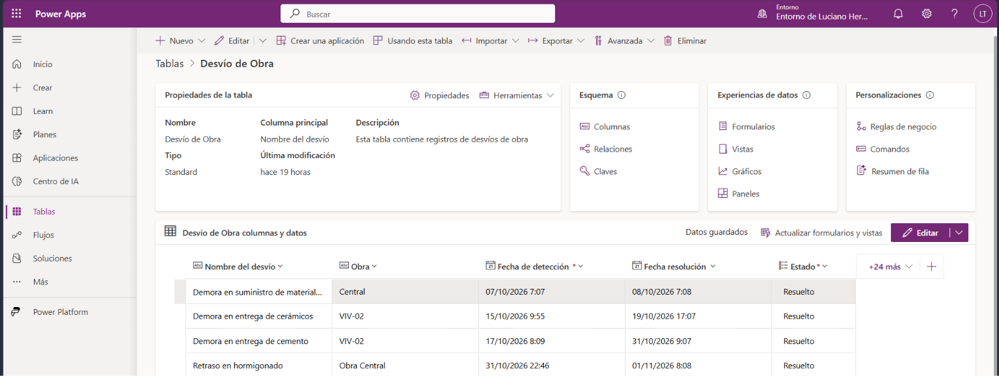 | El registro guardado en la tabla `Desvío de Obra` de Dataverse |
| 03 | 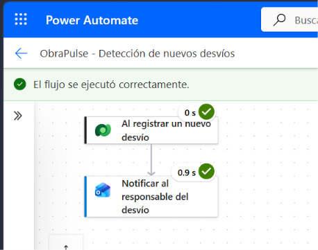 | Flujo "Detección de nuevos desvíos": disparador de Dataverse → notificación por correo, ambos pasos exitosos |
| 04 | 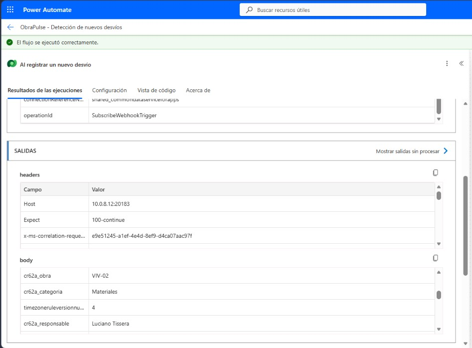 | Salidas del disparador con los datos del desvío (obra VIV-02, categoría Materiales, responsable) |
| 05 | 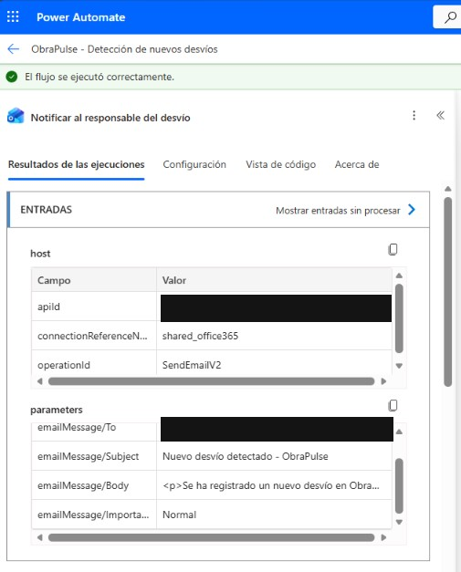 | Entradas del paso de notificación: conector Outlook (`SendEmailV2`) y asunto "Nuevo desvío detectado - ObraPulse" |

## 2. API de ObraPulse

| # | Evidencia | Qué demuestra |
|---|---|---|
| 06 | 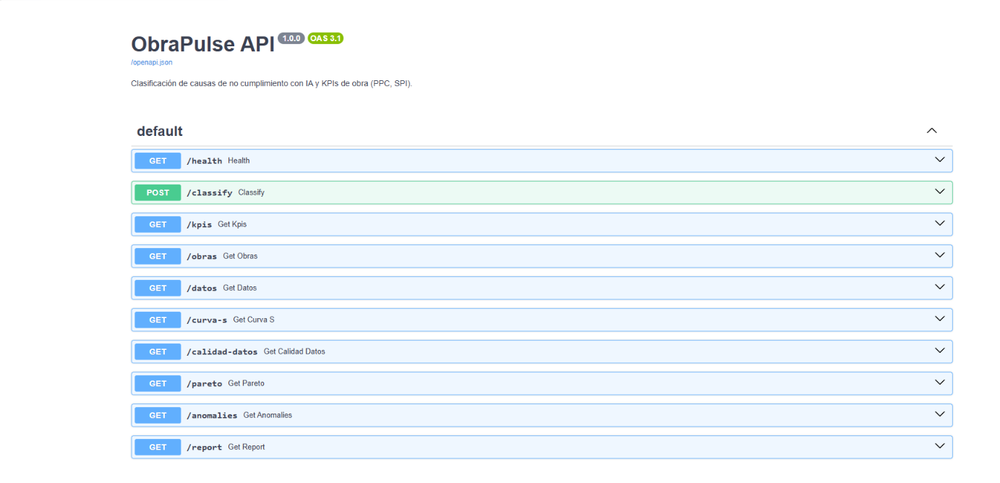 | Documentación OpenAPI con los endpoints: `/datos`, `/kpis`, `/obras`, `/pareto`, `/curva-s`, `/anomalies`, `/calidad-datos`, `/report` y `POST /classify` |

Para levantarla en local:

```powershell
.\.venv\Scripts\Activate.ps1
obrapulse serve
# Documentación: http://127.0.0.1:8000/docs
```

## 3. Integración con Power BI

| # | Evidencia | Qué demuestra |
|---|---|---|
| 07 | 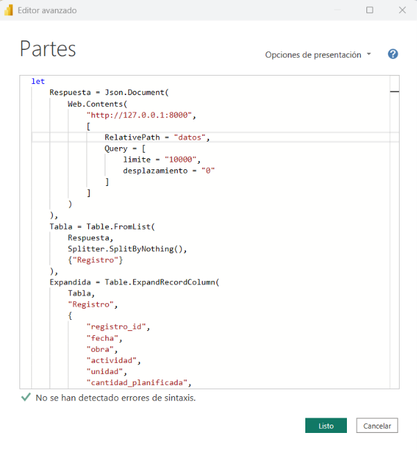 | Power Query consumiendo el endpoint `/datos` de la API (`Web.Contents`) |
| 08 | 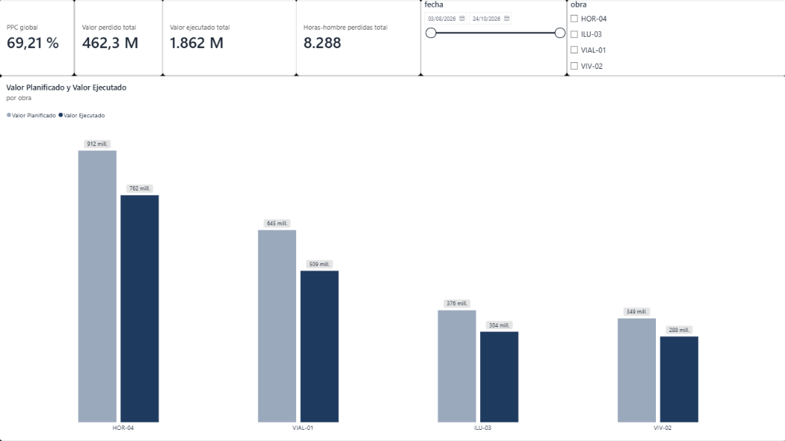 | Dashboard: PPC global, valor perdido y ejecutado, horas-hombre perdidas, y valor planificado vs. ejecutado por obra |

## 4. Reporte de cumplimiento (HTML generado por la API)

| # | Evidencia | Qué demuestra |
|---|---|---|
| 09a | 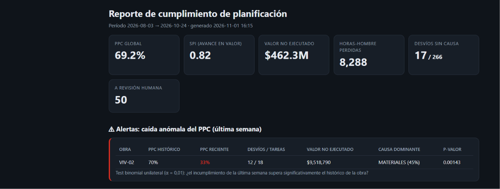 | KPIs globales (PPC 69,2 %, SPI 0,82) y alerta de caída anómala del PPC en VIV-02 (70 % → 33 %, test binomial unilateral, p = 0,00143) |
| 09b | 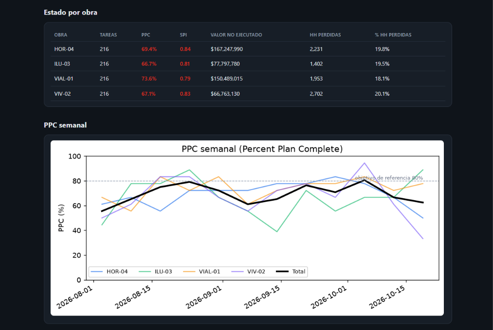 | Estado por obra y PPC semanal contra el objetivo de referencia del 80 % |
| 09c | 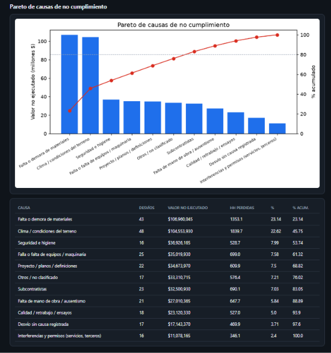 | Pareto de causas de no cumplimiento (valor no ejecutado y % acumulado) |
| 09d | 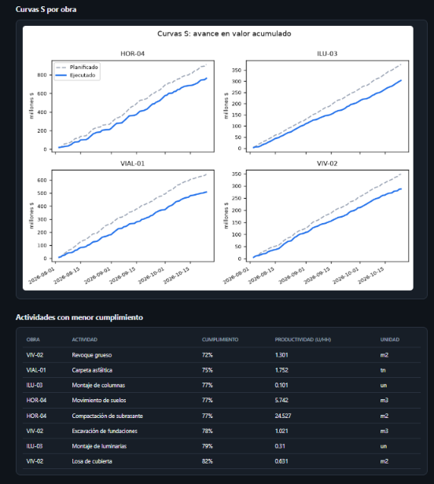 | Curvas S por obra: avance planificado vs. ejecutado en valor acumulado |
| 09e | 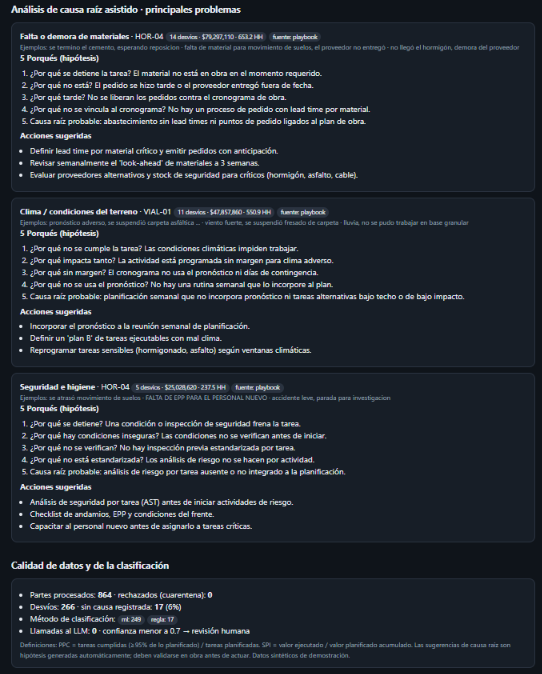 | Análisis de causa raíz asistido (5 porqués y acciones sugeridas) y calidad de datos y de la clasificación |

**Clasificación de causas:** 249 desvíos clasificados por modelo de ML y 17 por reglas. Los casos con confianza menor a 0,7 pasan a revisión humana (50 en esta corrida), y las llamadas a LLM fueron 0.

## Alcance

- Los datos son sintéticos y sirven para demostrar el flujo de trabajo; las sugerencias de causa raíz son hipótesis que deben validarse en obra.
- En esta versión, la captura de desvíos (Power Platform + Dataverse) y el análisis (API → Power BI y reporte HTML) funcionan como módulos independientes.
