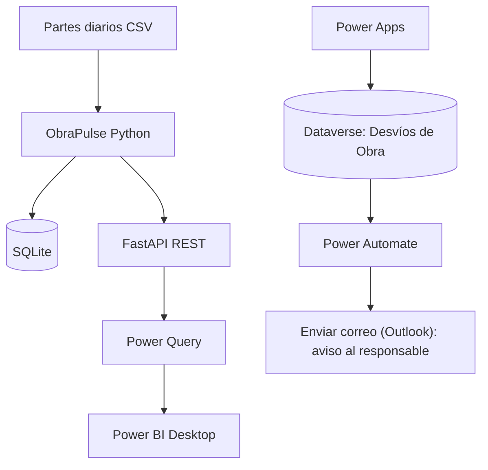

# Integración de ObraPulse con Microsoft Power Platform

Este documento registra la integración implementada y probada como parte del portfolio.
Distingue los componentes que ya funcionan de las conexiones que todavía son una evolución
pendiente.

## 1. Arquitectura implementada

### Componentes y responsabilidades

| Componente | Responsabilidad | Estado |
|---|---|---|
| Python / ObraPulse | Ingesta, validación, KPIs, clasificación y análisis | Implementado |
| SQLite | Persistencia de resultados del pipeline | Implementado |
| FastAPI | Exposición de resultados mediante API REST | Implementado |
| Power Query | Consulta los endpoints de ObraPulse | Implementado en los archivos `.m`; verificar en el PBIX local |
| Power BI Desktop | Visualización y análisis de indicadores | Modelo y consultas documentados; verificar el PBIX local |
| Power Apps | Alta, consulta y edición de desvíos | Aplicación creada y probada manualmente |
| Dataverse | Tabla `Desvíos de Obra` | Tabla creada y probada |
| Power Automate | Detecta la creación de filas en Dataverse | Flujo activado y ejecución de prueba exitosa |
 | Enviar correo (Outlook) | Notifica al responsable del desvío | Envía el aviso por correo; no llama a Python |

## 2. Integración Python → Power BI

La integración existente se realiza mediante HTTP:

1. Ejecutar `obrapulse run` para procesar los datos.
2. Ejecutar `obrapulse serve` para iniciar FastAPI.
3. Configurar `pBaseUrl` en Power Query con `http://127.0.0.1:8000`.
4. Configurar `pApiKey` vacío si no se definió `API_KEY`; de lo contrario, usar la clave configurada localmente.
5. Actualizar las consultas en Power BI Desktop.

Consultas incluidas en `powerbi/queries/`:

| Consulta | Endpoint |
|---|---|
| `Partes` | `GET /datos` |
| `ResumenObras` | `GET /obras` |
| `CurvaS` | `GET /curva-s` |
| `ParetoCausas` | `GET /pareto?por=categoria` |
| `Anomalias` | `GET /anomalies` |
| `CalidadDatos` | `GET /calidad-datos` |

La función `fnObraPulseGet.m` centraliza las llamadas HTTP y agrega el encabezado `X-API-Key` cuando se configura una clave.

**Alcance:** Power BI consume los resultados ya procesados por ObraPulse. Consultar la API no ejecuta nuevamente el pipeline ni vuelve a llamar al modelo de IA.

## 3. Integración Power Apps → Dataverse → Power Automate

Configuración realizada en el entorno de Power Platform:

### Dataverse

Tabla: `Desvíos de Obra`  
Nombre lógico informado por el entorno: `cr62a_desviodeobra`.

Columnas configuradas para gestionar los casos:

- Nombre del desvío
- Registro ID
- Obra
- Actividad
- Categoría
- Descripción
- Estado
- Responsable
- Observaciones
- Fecha de detección
- Fecha de resolución

Se creó un registro de prueba y luego se modificó su estado a `En revisión`, verificando la edición desde la aplicación.

### Power Apps

Aplicación de gestión creada sobre la tabla de Dataverse. Se comprobó el alta, visualización y modificación manual de un registro.

### Power Automate

Flujo: `ObraPulse - Detección de nuevos desvíos`.

Configuración comprobada:

- Desencadenador: Microsoft Dataverse — Cuando se agrega, modifica o elimina una fila.
- Tipo de cambio: `1` (agregada).
- Tabla: `Desvíos de Obra` (`cr62a_desviodeobra`).
- Ámbito: Organización.
- Acción: `Enviar un correo electrónico (V2)` de Outlook, llamada "Notificar al responsable del desvío", con asunto `Nuevo desvío detectado - ObraPulse`.
- Estado: activado.
- Prueba: ejecución correcta al crear un nuevo registro de prueba en Dataverse.

**Qué demuestra esta prueba:** Dataverse dispara el flujo y Power Automate ejecuta la acción configurada.

**Qué no demuestra todavía:** el flujo no invoca la API Python ni actualiza SQLite. El correo confirma que el disparador detecta el desvío nuevo y que el flujo actúa con sus datos.

## 4. Cómo demostrarlo en una entrevista

Se recomienda mostrar estas evidencias, en este orden:

1. Ejecutar ObraPulse y abrir `http://127.0.0.1:8000/docs`.
2. Mostrar `GET /health` y `GET /datos`.
3. Mostrar en Power Query la función `fnObraPulseGet` y la consulta `Partes`.
4. Actualizar el dashboard de Power BI Desktop.
5. Mostrar la aplicación Power Apps con un registro de desvío.
6. Mostrar la tabla `Desvíos de Obra` en Dataverse.
7. Mostrar el historial de ejecución exitoso del flujo de Power Automate.

Usar datos sintéticos de demostración. No presentar los indicadores como resultados de una obra real.

## 5. Límites y siguiente evolución

La conexión de Power BI con `127.0.0.1` está pensada para una demostración local. Power BI Service no puede acceder directamente al localhost de la PC; para actualización en la nube se requiere desplegar la API en un host accesible y protegido o configurar un gateway local administrado.

La siguiente mejora de Power Automate sería complementar la notificación con una llamada a la API.

La integración actual de Power Apps/Dataverse/Power Automate es un módulo de gestión y automatización separado del pipeline Python. Para sincronizar ambos sentidos se deberá definir un contrato de datos y una estrategia de autenticación, idempotencia y manejo de errores.
